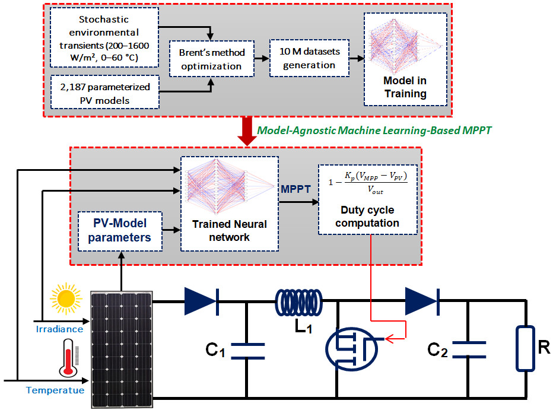
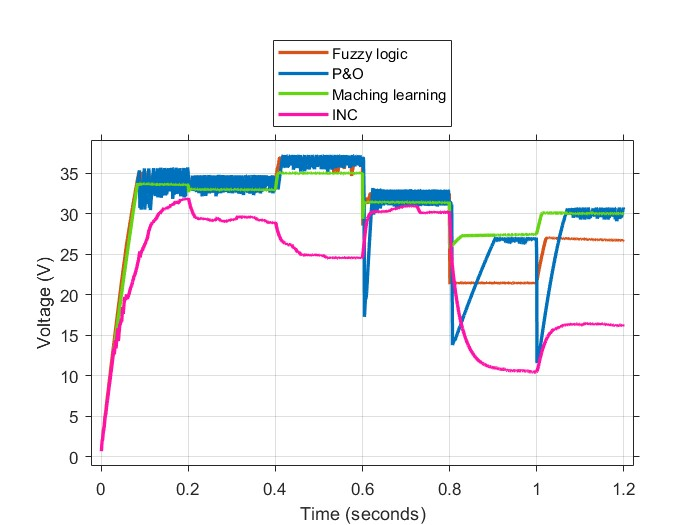

# Model-Agnostic Machine Learning MPPT for Photovoltaic Systems

**Development and validation of a model-agnostic ML framework for PV performance under complex weather conditions**

Abdelhak Samir Douli, Abd Essalam Badoud, Belkacem Ould Bouamama, Mahdi Boukerdja
*LAS, Université Sétif 1 (Algeria) · CRIStAL UMR 9189, Université de Lille (France)*

📄 Published in **Results in Engineering** 28, 108237 (2025) · [doi:10.1016/j.rineng.2025.108237](https://doi.org/10.1016/j.rineng.2025.108237)

---



## Idea

A neural network that predicts the maximum power point voltage of **any** PV module, without retraining.
The network gets the module's datasheet parameters as inputs, together with the irradiance and temperature measurements. The same pre-trained weights can then be deployed on a new panel by entering its parameters.

## Method

* **Dataset:** 2,187 parameterized PV models (Ns, Rs, Rsh, n, I₀, α_Isc, β_Voc), irradiance from 200 to 1600 W/m², temperature from 0 to 60 °C. That gives more than **10 million samples**, each labelled with the exact V_MPP from **Brent's method**.
* **Model:** feed-forward network with a bottleneck (9 inputs → 16 → 9 → 1), small enough for real-time inference.
* **Control:** the predicted V_MPP sets the boost converter duty cycle through a proportional law.
* **Benchmark:** P&O, incremental conductance (INC) and fuzzy logic control (FLC) on **four commercial modules**: Aavid Solar ASMS-165P, A2Peak POWER ON P220-6x10, Aavid Thermalloy ASMP-175M and Ablytek 5MN6C175-A0. Each was tested under standard conditions, irradiance steps, temperature steps and combined variations, in MATLAB/Simulink.

## Results (summary over the four modules)

| Method | Avg. tracking efficiency | Power oscillations | Needs retuning for a new module? |
|---|---|---|---|
| **ML (this work)** | **> 99.9 %** | **± 0.03 – 0.06 W** | **No**, only module parameters are entered |
| Fuzzy logic | 98.8 – 99.1 % | ± 1.5 – 2.5 W | Yes, the rule base must be redesigned |
| P&O | 95.5 – 97.1 % | ± 1.4 – 3.2 W | Step size must be retuned |
| INC | 91.4 – 99.8 % | ± 0.5 – 1.8 W | Works, but performance is inconsistent |

The ML controller settles in about **70 ms**.


*PV voltage under combined variations: the ML controller (green) moves directly to each new MPP, without the oscillations of P&O or the drift of INC.*

## Follow-up work

* [bg-ml-mppt-pv](https://github.com/abdelhaksamirdouli/bg-ml-mppt-pv) extends this idea with a **bond graph** model of the module, a single-module ablation and a sensitivity study (accepted in *Energies*).

## Tools

MATLAB/Simulink · Python · PyTorch · ONNX · SciPy

## Code

The simulation models and training code are kept in a private repository during the PhD. They are **available on request**: abdelhak.samir.douli@gmail.com.

## Citation

```bibtex
@article{douli2025modelagnostic,
  author  = {Douli, Abdelhak Samir and Badoud, Abd Essalam and Ould Bouamama, Belkacem and Boukerdja, Mahdi},
  title   = {Development and validation of a novel model-agnostic machine learning framework for photovoltaic systems performance assessment under complex weather conditions},
  journal = {Results in Engineering},
  volume  = {28},
  pages   = {108237},
  year    = {2025},
  doi     = {10.1016/j.rineng.2025.108237}
}
```

## Funding

This work was supported by the PHC Tassili project No. 51327SE, *Integrated Design of Resilient Systems for Green Hydrogen Production*.
